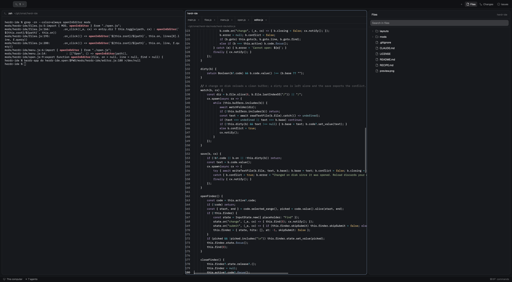

# herdr-ide

An editor for the [Herdr](https://herdr.dev) desktop app: a file tree with project search in the right panel, and a tabbed editor pane beside your terminals. Click a file to open it, Cmd-F to find, Cmd-S to save; scripts and agents can open a file with `herdr-app do herdr-ide.open:<path>[:<line>]`. It uses the mouse and has no language servers.



## Install

Ask the agent in Herdr:

```
Read ~/.config/herdr-app/AGENTS.md, then add this mod: herdr.dev/mods/mikkokam/herdr-ide
```

Or copy `mods/herdr-ide` to `~/.config/herdr-app/mods/` and `layouts/main-ide.json` to `~/.config/herdr-app/layouts/`, then run `herdr-app do layout.switch '{"name":"main-ide"}'`.

`RECIPE.md` describes the behaviour in full.

## Licence

Apache 2.0. `files.js` and `editor.js` are derived from Herdr's shipped `files` and `editor` mods, which are Apache 2.0.
