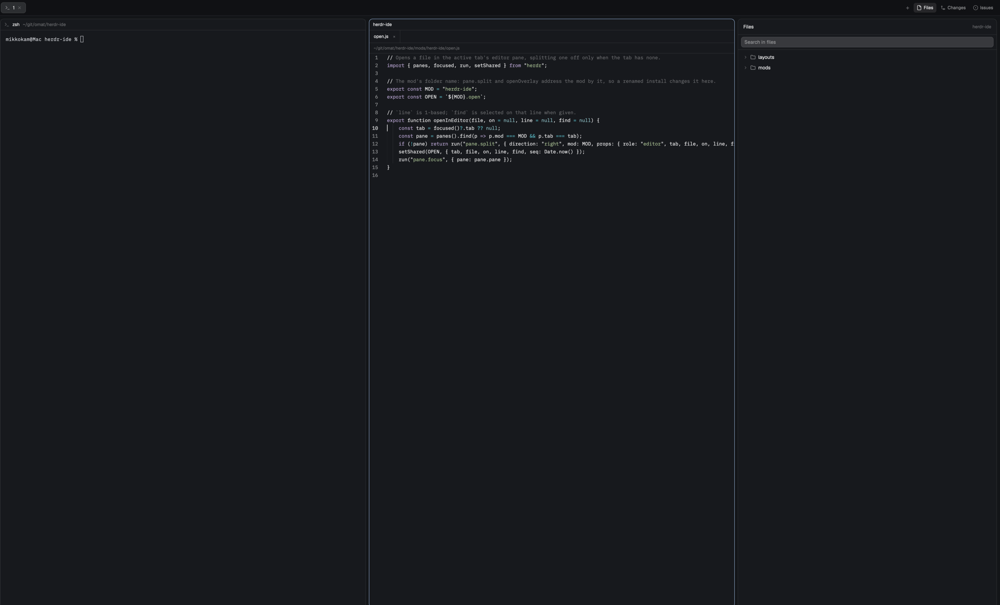

# Herdr IDE

A file tree with project search in Herdr's right panel, and a tabbed editor pane beside the terminals: one click on a file opens it, Cmd-F finds in it, Cmd-S saves it. No language servers.

## What you see

- **The Files panel**, in the panel stack where Herdr's `files` sits: a 42px header ("Files" and the folder's name), a search field, then the tree of the focused terminal's folder with git marks (A, M, D, U) as in Herdr's `files`.
- **Search results**, in place of the tree while the field has text: one row per file (relative path and match count), then one row per match (line number and the trimmed line), at most 1,000 matches.
- **The editor pane**, split off to the right of the focused pane the first time a file is opened in a tab: a tab strip (file name, the parent folder when two open files share a name, × or ● when unsaved), a path bar (path, "read-only" for files on another machine, Reload on a conflict, Preview or Edit for Markdown and SVG, Save while unsaved), then the editor with syntax highlighting, line numbers and folding.
- **The preview**, in place of the editor for a file that is not text, and for an SVG until Edit: a bar with "Open in default app", then for png, jpg, gif, webp and SVG the image at its natural size or the pane's width, whichever is smaller; for a PDF its pages at the pane's width, at most 50, with "First 50 of n pages." under a longer one; for anything else "Not a text file." An SVG with unsaved edits adds "Showing the saved file." On another machine the bar says previews and Open in default app work only for files on this computer, and an SVG there opens in Edit; on Linux and Windows the bar says they need macOS.
- **The find bar**, under the path bar after Cmd-F: the query, "n of m" or "No results", ↑, ↓ and ×.
- **The right-click menu** on a tree row, in three groups: Open, Open in Zed, Open with default app (files only; folders get Open in Zed); Reveal in Finder; Copy path, Copy relative path.

## How it behaves

- A click on a file opens it in the active tab's editor pane, or splits one off when the tab has none. A file already open is brought to the front. A click on a search match opens the file with that match selected.
- Search is fixed-string and smart-case (a capital letter makes it match case), runs 200 ms after typing stops, uses `rg` when the machine has it (so `.gitignore` applies) and `grep` otherwise. Esc in the field clears it and brings the tree back.
- Cmd-F opens the find bar, seeded with the selection when it is on one line. Typing selects the first match at or after the cursor; Enter or Cmd-G goes to the next, Shift-Enter or Cmd-Shift-G to the previous, wrapping; Esc closes the bar and returns to the editor.
- Cmd-S saves. A file changed on disk reloads when the buffer is clean; when it is dirty, Save reports the conflict and Reload discards the edits. Closing an unsaved tab asks for a second close. Middle-click closes a tab.
- Files on another machine open read-only, since `writeTextFile` writes only on this computer.
- A file is not text when its extension is png, jpg, gif, webp, pdf or a known binary format, or when it holds a NUL byte or fails to decode as UTF-8. Open in default app runs `open <path>`.
- A PDF is rendered once per path, mtime and size, through PDFKit (`osascript -l JavaScript`).
- `herdr-app do herdr-ide.open:<path>` or `herdr-ide.open:<path>:<line>` opens a local file, given by its absolute path, in the shown editor pane, so a script or an agent can show you a file.
- Each editor pane remembers its open files per Herdr tab in `localStorage`.
- While the editor has the keyboard, the tree stays on the last terminal's folder.

## Built from

- **Mod** `mods/herdr-ide/`, one mod in three roles chosen by `props.role`: `files` (the layout block), `editor` (`pane.split`), `menu` (a popup). `files.js` is a `mod.clone` of Herdr's `files` (0.1.16) with search, the open routing and the menu added; `editor.js` started from Herdr's `editor` (0.1.16).
- **Layout** `layouts/main-ide.json`: Herdr's `main` (0.1.16) with the `files` block's content set to `{ "mod": "herdr-ide", "props": { "role": "files" } }`.
- **herdr**: `panes`, `focused`, `spaces`, `run` (`pane.split`, `pane.focus`), `shared` / `setShared` (`herdr-ide.open`, `herdr-ide.previews`), `nextCommand` (`open:`), `openOverlay`, `closeOverlay`, `exec`, `readTextFile`, `writeTextFile`, `watchFolder`, `appHome`, `window`.
- **gpui-kit**: `image` for previews.

## Watch out

- Herdr refuses imports across mod folders, so everything lives in one mod. The mod addresses itself by name in `open.js` (`MOD`); an install under another folder name must change that constant and the layout's `mod`.
- To use your own layout instead of `main-ide`, set its `files` block's content as above.
- A mod pane cannot set its header title, so the editor pane's header reads `herdr-ide`.
- `herdr-app ls` does not list mod panes.
- `herdr-ide.open` reaches only an editor pane that is shown; with none in the shown tab, it does nothing.
- Search runs `rg` from the app's own PATH: a Homebrew `rg` the login shell finds is used, a shell alias or function is not.
- "Open in Zed" runs `open -a Zed`; it does nothing without Zed installed, and nothing on Linux or Windows.
- `image()` reads only paths inside the app folder, so previews go through `~/.config/herdr-app/cache/herdr-ide/`: a symlink to each image, a folder of page PNGs for each PDF. Each new preview removes the older versions of its file, then the least recently opened entries until the cache is under `CACHE_LIMIT_KB` (`cache.js`). Previews open in a tab that shows an editor pane, and the one just written, are never removed, so they can hold the cache over the limit. Deleting the folder is safe.
- Changes on disk to an open image or PDF show only after the tab is closed and opened again.

## Done when

- `herdr-app check ~/.config/herdr-app/mods/herdr-ide` passes.
- `herdr-app do layout.switch '{"name":"main-ide"}'` shows the Files panel with a search field.
- A click on a file splits off one editor pane; a second file opens as a second tab in it.
- Typing a word in the search field lists matches; a click on one opens the file with the match selected.
- Cmd-F, a query and Enter step through matches; Cmd-S writes the file.
- `herdr-app do herdr-ide.open:$PWD/README.md:3` with an editor pane shown opens README.md at line 3.
- `herdr-app do herdr-ide.open:$PWD/preview.png` with an editor pane shown shows the image and Open in default app; a PDF opened the same way shows its pages.
